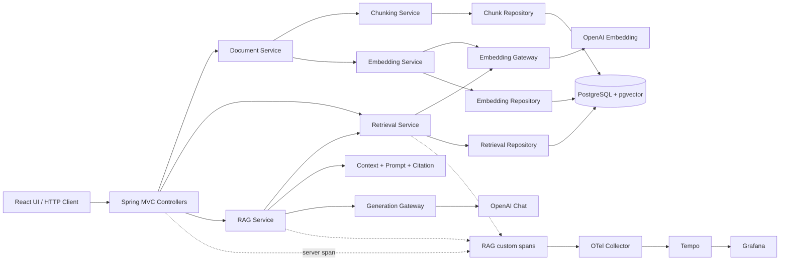
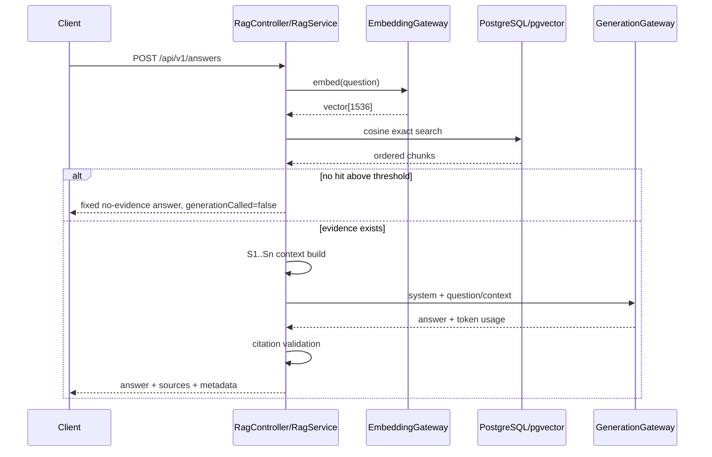

# 백엔드 신입 개발자 채용용 포트폴리오 구성안

- 기반 자료: `docs/PORTFOLIO_AUDIT.md`와 현재 repository 구현
- 대상 독자: 개발 실무자, 기술 면접관, 채용 담당자
- 권장 형태: README 또는 포트폴리오 웹 페이지 1개 + 상세 기술 문서 링크 + Git repository
- 핵심 원칙: “OpenAI API를 호출했다”가 아니라 “검색·생성 pipeline의 경계, 실패 상태, 품질 평가, 요청 관측성을 직접 설계하고 검증했다”를 실제 코드로 증명한다.

## 전체 편집 전략

독자별로 읽는 깊이가 다르므로 한 페이지 안에 세 층을 만든다.

| 읽는 사람 | 첫 관심사 | 먼저 보여줄 내용 | 상세 근거 |
|---|---|---|---|
| 채용 담당자 | 무슨 문제를 풀었고 무엇을 만들었는가 | 한 줄 소개, 대표 architecture, 핵심 결과 3~4개, UI/Trace screenshot | 상세 기술 문서 링크 |
| 개발 실무자 | 실제 pipeline과 운영 경계가 타당한가 | ingestion/retrieval 흐름, DB 상태, 직접 SQL, timeout/error, test | class/method 및 integration test |
| 기술 면접관 | 왜 그렇게 설계했고 한계도 이해하는가 | ADR, transaction 경계, no-evidence gate, evaluation 설계, trade-off | 문제 해결 사례와 예상 질문 |

페이지의 권장 흐름은 이 문서의 섹션 순서를 그대로 따른다. 첫 화면에는 한 줄 소개, 4개 핵심 가치, 전체 architecture 그림, 대표 screenshot 1장만 둔다. 코드는 긴 전문 대신 8~20줄의 핵심 부분만 보여주고 해당 파일로 연결한다.

성과 표현은 반드시 세 종류를 구분한다.

- 구현 사실: 코드와 테스트로 확인 가능한 내용
- 실험 결과: frozen corpus와 특정 설정에서 얻은 수치
- 미검증 영역: 일반화·운영 성능·답변 정확성처럼 아직 증명하지 않은 내용

---

## 프로젝트 한 줄 소개

### 최종 문구

> 운영 문서를 Chunk·Embedding으로 변환해 pgvector에서 직접 검색하고, 근거 기반 답변의 전 과정을 OpenTelemetry Trace로 추적하며 retrieval 품질을 반복 검증한 Spring Boot RAG 프로젝트

짧은 카드나 이력서에는 다음 문구를 사용한다.

> 직접 구성한 RAG pipeline과 요청 단위 관측성을 갖춘 Spring Boot + pgvector 문서 검색 시스템

“OpenAI 기반 챗봇”을 제목으로 사용하지 않는다. Provider보다 pipeline, retrieval, 검증, 관측성이 이 프로젝트의 차별점이다.

### 첫 화면에 배치할 핵심 가치

1. 직접 구성: `upload → chunk → embedding → pgvector → retrieval → cited answer`
2. 검색 설명 가능성: Spring AI `VectorStore` 대신 cosine exact SQL과 filter/tie-break 직접 제어
3. 검증 가능성: frozen Golden Query, Hit@K/MRR/negative return, threshold·Top-K·Chunk Size 비교
4. 추적 가능성: API response의 `X-Trace-Id`로 단계별 `rag.*` span 조회

### 반드시 보여줘야 할 코드

- 이 섹션에서는 코드 전문을 넣지 않는다.
- 대신 대표 구현 링크 3개를 붙인다: `RetrievalRepository.searchSimilar`, `RagService.answerTraced`, `RagTracing.trace`.

### 반드시 보여줘야 할 diagram

- 한 줄 pipeline ribbon: `Document → Chunk → Embedding → pgvector → Retrieval → Context → LLM Answer`.
- 우측에 `HTTP request → Trace ID → Tempo`를 별도 선으로 연결한다.
- 첫 화면용이므로 class 이름이나 세부 attribute는 넣지 않는다.

### screenshot이 필요한 화면

- 대표 screenshot 1장: 프론트엔드 “검색·질문” 화면에서 답변, `[S1]` source, Trace ID가 한 화면에 보이는 상태.
- 실제 API 결과를 사용할 경우 화면에 “로컬 API 연결”이 보여야 한다. demo mode라면 반드시 “설명용 예시” 표시까지 포함한다.

### 정량화 가능한 지표

- 첫 화면에는 `Backend tests 128`, `custom RAG spans 7`, `validation queries 18`, `vector dimensions 1536` 정도만 사용한다.
- 테스트는 “128개 전부 통과”라고 쓰지 않는다. 감사 시점 결과는 124 pass, 4 opt-in skip이다.
- 18개 query 결과를 일반 검색 정확도로 표현하지 않는다.

---

## 문제 정의

### 전달할 메시지

일반적인 LLM API 연결만으로는 다음 질문에 답하기 어렵다는 문제에서 출발한다.

- 답변이 어떤 내부 문서를 근거로 했는가?
- 검색 결과가 없을 때도 LLM이 답을 만들어내지 않는가?
- Embedding model이 바뀌었는데 과거 vector와 섞여 검색되지 않는가?
- 느리거나 실패한 구간이 query embedding, DB retrieval, generation 중 어디인가?
- Chunk Size, threshold, Top-K 선택이 실제 retrieval 품질에 어떤 영향을 미쳤는가?
- 외부 API 실패 중 일부 vector나 애매한 상태가 남지 않는가?

이 프로젝트는 이 문제를 “직접 제어 가능한 pipeline + 명시적 상태 + 재현 가능한 평가 + 요청 단위 trace”로 해결하려 했다고 설명한다.

### 권장 본문 구성

1. 문제 상황: 운영 runbook이 길어 필요한 근거를 찾기 어렵다.
2. 단순 챗봇 접근의 부족함: retrieval 근거, 실패 경계, 품질 측정, latency stage가 보이지 않는다.
3. 프로젝트 목표: 답변 생성 자체보다 검색 근거와 처리 과정을 검증 가능하게 만든다.
4. 범위 선언: 로컬 3-document corpus를 사용한 포트폴리오 baseline이며 production-ready 서비스는 아니다.

### 반드시 보여줘야 할 코드

- `RagService.answerTraced`: hit가 없으면 Generation을 호출하지 않는 분기.
- `RetrievalRepository.searchSimilar`: 검색 가능한 Chunk의 상태·모델 조건.
- `EmbeddingTransactions.claim/complete/fail`: 실패 시 상태를 보존하는 경계.

### 반드시 보여줘야 할 diagram

“단순 LLM 호출”과 “이 프로젝트”를 비교하는 2열 diagram.

```text
단순 API 연결                    이 프로젝트
Question                         Document ingestion
  → LLM                           → Chunk → Embedding → pgvector
  → Answer                       Question
                                   → Retrieval → Evidence gate
                                   → Context → Generation → Citation validation
                                 각 단계 → Trace / Test / Evaluation
```

### screenshot이 필요한 화면

- 근거가 있는 답변과 source card가 함께 보이는 화면.
- 근거 없는 질문에서 고정 응답, source 0개, `generationCalled=false`가 보이는 API 응답 또는 UI 화면.
- 두 화면을 나란히 두면 문제 정의가 기능 설명으로 자연스럽게 연결된다.

### 정량화 가능한 지표

- 지원 파일: TXT/Markdown, 최대 1MB.
- 기본 Chunk Size 600 tokens, 문서당 최대 500 chunks.
- Embedding 1536차원, 기본 batch 32.
- 답변 default minimum similarity 0.5, 검색 default 0.0. 두 값이 목적에 따라 분리됐음을 설명하되 0.5가 최적이라고 주장하지 않는다.

---

## 핵심 기능

### 전달할 메시지

기능 목록은 UI 버튼이 아니라 backend 책임 단위로 묶는다.

| 기능 | 실제 구현 | 설계상 의미 |
|---|---|---|
| Document 관리 | UTF-8 TXT/Markdown upload, 조회, 제목 변경, hard delete | 입력 검증과 corpus lifecycle |
| Chunking | Spring AI `TokenTextSplitter`, JTokkit token count | 원문을 retrieval 단위로 변환 |
| Embedding | batch 호출, vector response 검증, pgvector 저장 | provider output을 DB 계약으로 변환 |
| Retrieval | query embedding, exact cosine SQL, threshold/Top-K | 검색 정책을 직접 통제 |
| RAG answer | ordered Context, source ID, no-evidence gate, citation validation | 생성 결과를 근거와 연결 |
| Evaluation | frozen dataset, baseline, threshold/Top-K/Chunk Size 비교 | 설정을 감이 아니라 지표로 검토 |
| Observability | custom spans, safe attributes, `X-Trace-Id` | 요청별 latency/failure stage 추적 |
| Demo UI | document/search/answer/experiment view, demo/live mode | 기술 흐름을 채용 독자에게 시각화 |

문서 upload 후 Chunking과 Embedding은 자동 실행되는 하나의 endpoint가 아니다. 비용과 상태를 확인하며 각각 명시적으로 실행하는 세 단계라는 점을 정확히 표시한다.

### 반드시 보여줘야 할 코드

- `DocumentController`: 세 단계 API가 분리된 endpoint 목록.
- `DocumentService.validate`: extension, size, UTF-8, SHA-256 검증.
- `EmbeddingService.embedAll`: batch 처리와 순서 보존.
- `CitationValidator.validate`: 존재하지 않는 source ID 차단.

### 반드시 보여줘야 할 diagram

- Document/Embedding 이중 상태 머신.

```text
Chunking:  PENDING → PROCESSING → READY
                      │
                      └→ FAILED → PROCESSING (retry_count + 1)

Embedding: NOT_STARTED → PENDING → PROCESSING → READY
                                      │
                                      └→ FAILED → PROCESSING (embedding_retry_count + 1)
```

- `READY` Chunking 성공 시에만 Embedding이 `PENDING`으로 이동한다는 연결을 표시한다.

### screenshot이 필요한 화면

- 프론트 “문서 라이브러리”에서 Chunking 상태와 Embedding 상태가 별도 badge로 보이는 화면.
- 선택 문서의 원문/Chunk 탭, token count, embedded 여부가 보이는 화면.
- 실패 screenshot을 추가할 경우 안전한 error code와 retry count만 보이고 secret/provider 원문 오류가 없어야 한다.

### 정량화 가능한 지표

- 파일 1MB, title/filename 255자.
- Chunk 최대 500개.
- Embedding batch 32; 단위 테스트에서 70개를 `32/32/6`으로 호출하고 순서를 검증.
- API query/question 1~2,000자, Top-K 1~20, similarity -1~1.

---

## architecture

### 전달할 메시지

Spring MVC의 전형적 Controller-Service-Repository 구조 위에 AI provider adapter와 RAG 조립 계층을 분리했다. 핵심은 provider, persistence, application flow가 서로의 구체 타입에 침투하지 않도록 한 경계다.

### 메인 architecture diagram

이 diagram은 포트폴리오에서 가장 크게 보여준다.



diagram 아래에는 다음 경계를 짧게 설명한다.

- Spring AI: splitter/token estimator와 OpenAI model adapter에 사용.
- JDBC 직접 구현: Chunk/vector persistence 및 retrieval SQL.
- Gateway 분리: Embedding과 Generation의 timeout, 비용, 실패 영향 독립.
- AI provider `none`: API key 없이 app/health 부팅 가능.
- Docker Compose: PostgreSQL, Collector, Tempo, Grafana. Spring app과 Vite는 host 실행.

### 반드시 보여줘야 할 코드

- `EmbeddingGateway`와 `GenerationGateway` interface를 나란히 제시.
- `EmbeddingConfiguration.openAiEmbeddingGateway`, `GenerationConfiguration.openAiGenerationGateway`의 bean 선택과 timeout/retry 설정.
- `RetrievalRepository`가 Spring AI `VectorStore` 대신 JDBC를 사용한다는 부분.

### 반드시 보여줘야 할 diagram

- component deployment diagram: `Browser:5173 → Spring:8080 → PostgreSQL:5432`, `Spring → Collector:4318 → Tempo:4317`, `Grafana:3000 → Tempo:3200`.
- 포트 번호는 `compose.yaml`과 `application.yml`에서 확인한 값만 쓴다.

### screenshot이 필요한 화면

- architecture 섹션 자체에는 UI screenshot보다 diagram이 우선이다.
- 보조 자료로 Docker Compose service가 실행 중인 화면을 넣을 수 있으나, 이것을 시스템 정상 동작의 유일한 증거로 사용하지 않는다.

### 정량화 가능한 지표

- Java 21, Spring Boot 3.5.16, Spring AI 1.1.8.
- PostgreSQL 17, pgvector 0.8.6.
- OTel Collector 0.159.0, Tempo 2.10.8, Grafana 13.1.0.
- Hikari maximum pool size 10, connection timeout 3초. 이는 기본 설정이지 성능 성과가 아니다.

---

## RAG pipeline

### 전달할 메시지

이 프로젝트의 중심 섹션이다. ingestion과 online answer flow를 분리해 보여준다.

### A. Document ingestion

1. Upload: 파일 검증, UTF-8 decode, raw byte SHA-256, `PENDING` 저장.
2. Chunk: atomic claim, `TokenTextSplitter`, JTokkit token count, ordered batch insert.
3. Embedding: atomic claim, Chunk batch, OpenAI Embedding, response validation, `VECTOR(1536)` 저장.
4. Eligibility: Chunking과 Embedding이 모두 READY인 문서만 retrieval 후보가 된다.

### B. Online retrieval/answer

1. question normalization과 request option 결정.
2. 동일 Embedding Gateway로 query vector 생성.
3. provider/model/dimensions가 같은 READY Chunk만 exact cosine search.
4. threshold 적용 후 distance와 deterministic tie-break로 정렬, Top-K 제한.
5. hit가 없으면 Generation 생략.
6. hit가 있으면 S1..Sn Context를 만들고 system/user prompt로 Generation 호출.
7. citation ID를 검증한 뒤 answer/source/meta 반환.

### 반드시 보여줘야 할 코드

코드 전문 대신 다음 네 개의 짧은 발췌를 순서대로 배치한다.

1. `SpringAiDocumentChunker.split`: text → ordered `ChunkDraft`.
2. `EmbeddingVectorValidator.validateVector`: 1536/finite/non-zero 계약.
3. `RetrievalRepository.searchSimilar`: `<=>`, `1 - distance`, filter, tie-break.
4. `RagService.answerTraced`: no-evidence 분기와 context/generation/citation 순서.

SQL 발췌에는 반드시 아래 조건이 보이게 한다.

```sql
d.status = 'READY'
d.embedding_status = 'READY'
dc.embedding_provider = :embeddingProvider
dc.embedding_model = :embeddingModel
vector_dims(dc.embedding) = :dimensions
dc.embedding <=> CAST(:queryEmbedding AS vector)
```

### 반드시 보여줘야 할 diagram

Online answer sequence diagram.



Ingestion은 별도의 flowchart로 그린다. 한 diagram에 두 흐름을 모두 넣어 읽기 어렵게 만들지 않는다.

### screenshot이 필요한 화면

- search-only 응답: ordered result와 similarity가 보이는 화면.
- answer 응답: `[S1]`과 source metadata가 대응되는 화면.
- no-evidence 응답: generationCalled=false와 null token usage가 보이는 JSON 또는 UI.
- DB screenshot을 넣는다면 vector 1536개 값을 펼치지 말고 `vector_dims`, provider/model, count 집계만 보여준다.

### 정량화 가능한 지표

- local sample 3개 문서의 600-token split 결과: 5 + 4 + 4 = 13 Chunk. 출처: `docs/retrieval-lab-results.md`와 저장 실험 결과.
- embedding dimensions 1536, default batch 32.
- exact cosine search, default search Top-K 5.
- source excerpt 기본 최대 500 code points; LLM Context에는 Chunk 전문 전달.
- connect/read timeout: Embedding 3초/30초, Generation 3초/60초.

### 과장 방지 문구

- “Markdown parser를 구현했다”라고 쓰지 않는다. Markdown도 raw UTF-8 text로 처리한다.
- “reranking을 구현했다”라고 쓰지 않는다. ranking은 cosine distance뿐이다.
- “vector DB를 구축했다”보다 “PostgreSQL pgvector column과 직접 SQL 검색을 구현했다”가 정확하다.
- “hallucination을 방지했다” 대신 “근거 없는 Generation 경로와 잘못된 citation ID를 차단했다”라고 쓴다.

---

## Observability

### 전달할 메시지

단순히 OpenTelemetry dependency를 추가한 것이 아니라, 사용자가 받은 API response와 내부 RAG stage를 같은 trace ID로 연결했다. 정상, no-evidence, 실패가 서로 다른 span 구조와 attribute로 남는다.

### 반드시 보여줘야 할 코드

- `RagTracing.trace`: span 생성, scope, success/error outcome, 안전한 error 기록.
- `TraceHeaderFilter.doFilterInternal`: current trace ID를 `X-Trace-Id` response header에 설정.
- `RetrievalService.searchTraced`: `rag.query_embedding`/`rag.vector_search`.
- `RagService.answerTraced`: context/generation/citation span과 no-evidence attribute.
- `infra/otel-collector/config.yaml`: OTLP receiver → batch → Tempo exporter.

### 반드시 보여줘야 할 diagram

정상 answer trace tree와 no-evidence trace tree를 나란히 보여준다.

```text
정상 답변                              근거 부족
HTTP SERVER                            HTTP SERVER
└─ rag.answer                          └─ rag.answer [no_evidence]
   ├─ rag.retrieval                       └─ rag.retrieval
   │  ├─ rag.query_embedding                 ├─ rag.query_embedding
   │  └─ rag.vector_search                   └─ rag.vector_search [empty]
   ├─ rag.context_build                  generation.called=false
   ├─ rag.generation
   └─ rag.citation_validation
```

별도 correlation diagram도 작게 둔다.

```text
API response X-Trace-Id
        = HTTP server trace ID
        → Grafana Explore / Tempo lookup
        → 단계별 duration, outcome, safe error code 확인
```

### screenshot이 필요한 화면

반드시 다음 3장을 준비한다.

1. API response header의 `X-Trace-Id`.
2. 동일 ID를 Grafana Explore/Tempo에 입력한 화면.
3. Tempo waterfall에서 7개 custom span과 parent-child 구조가 보이는 화면.

가능하면 no-evidence trace도 추가해 `rag.generation`이 없고 `rag.generation.called=false`인 점을 보여준다. screenshot에는 API key, 질문 전문, Context, provider 원문 error가 없어야 한다. 기존 문서의 Trace ID는 retention 24시간 때문에 조회되지 않을 수 있으므로 발표 전에 Fake integration path로 새 trace를 만든다.

### 정량화 가능한 지표

- 정상 answer: custom span 7개.
- search-only: custom span 3개.
- no-evidence answer: custom span 4개, generation span 0개.
- trace sampling 기본 1.0.
- Tempo block retention 24시간.
- Collector batch timeout 1초.

### 정확히 밝혀야 할 범위

- custom tracing은 search/answer에만 적용된다.
- upload/chunking/document embedding custom span, custom metrics, log pipeline, dashboard/alert는 없다.
- `X-Trace-Id`는 search/answers response에만 붙는다.
- trace ID는 app이 UUID로 새로 만든 값이 아니라 current HTTP server span의 ID다.

---

## 기술적 의사결정

### 전달 방식

기능 선택을 나열하지 말고 “맥락 → 선택 → 얻은 것 → 비용/후속 조건”의 4열 표로 보여준다. 원문 ADR을 상세 링크로 연결한다.

| 결정 | 맥락 | 선택과 얻은 것 | 비용/한계 |
|---|---|---|---|
| 직접 pgvector SQL | 검색 정책과 점수식을 설명해야 함 | `<=>`, threshold, filter, tie-break를 직접 통제 | mapping/SQL/DB 이식 책임 증가 |
| exact search 우선 | corpus가 작고 품질 baseline이 우선 | ANN 변수를 제거한 재현 가능한 ranking | corpus 증가 시 scan 비용 증가 |
| Embedding/Generation Gateway 분리 | 비용·timeout·실패 영향·model lifecycle이 다름 | 독립 adapter/test/error boundary | interface/config code 증가 |
| vector 1536 고정 | DB column과 model contract mismatch 방지 | startup/response 단계 fail-fast | 모델 변경 시 migration+re-embedding 필요 |
| 수동 ingestion 단계 | 유료 호출과 상태를 사용자가 제어 | 단계별 관찰·retry·실패 검증 용이 | queue/background throughput 없음 |
| no automatic provider retry | 비용·중복·긴 latency를 숨기지 않음 | 명시적 FAILED와 수동 retry | transient failure 회복성 낮음 |
| search/answer threshold 분리 | 탐색과 생성 gate의 목적이 다름 | 검색 관찰 0.0, 답변 gate 0.5 | 현재 실험으로 0.5 최적성 미입증 |
| trace에 safe metadata만 기록 | stage는 봐야 하나 질문/Context/error는 민감 | count/model/code 중심 observability | 내용 기반 debugging 정보 제한 |

### 반드시 보여줘야 할 코드

- `docs/adr/0001-use-direct-pgvector-sql.md`~`0004` 링크.
- `EmbeddingProperties.validate`: DB dimension과 provider config fail-fast.
- `RetrievalRepository.searchSimilar`: 결정이 실제 코드에 반영된 증거.
- 두 Configuration의 `RetryTemplate.maxAttempts(1)`.

### 반드시 보여줘야 할 diagram

- 의사결정 tree 1개: corpus 규모/품질 baseline 필요 → exact search, p95 목표 미달/규모 증가 → 동일 Golden Set으로 ANN 재검토.
- model lifecycle diagram: embedding model 변경 → 전체 vector 재생성, generation model 변경 → 기존 vector 유지 가능.

### screenshot이 필요한 화면

- 별도 UI screenshot은 필요 없다.
- ADR 문서의 제목/상태/결정 부분을 한 장의 montage로 보여줄 수 있다. 코드보다 문서화 습관을 보여주는 용도다.

### 정량화 가능한 지표

- ADR 4개.
- vector 1536 dimensions.
- provider max attempts 1.
- search default threshold 0.0, answer default 0.5.
- 이 값들은 결정의 parameter이며 성과 지표가 아니다.

---

## 문제 해결 사례

문제 해결 사례는 감사 문서의 다섯 사례를 STAR보다 기술적인 “문제 → 원인/위험 → 구현 → 검증 → 남은 한계” 형식으로 작성한다. 각 사례를 1페이지 또는 접을 수 있는 카드로 구성한다.

### 사례 1. 외부 Embedding 실패 후 partial vector와 유실된 상태 방지

- 문제: 여러 batch 중 하나가 실패하면 일부 vector만 남거나 transaction rollback으로 실패 상태가 사라질 수 있다.
- 구현: `claim → 외부 호출/전체 검증 → complete`, 실패 시 별도 `fail` transaction에서 vector clear와 FAILED 기록.
- 검증: `EmbeddingApiIntegrationTests.providerFailureLeavesNoPartialVectorsAndFailedDocumentCanRetry`.
- 한계: 자동 retry/backoff/queue는 없다.

### 사례 2. 현재 query model과 호환되지 않는 저장 vector 혼입 방지

- 문제: 서로 다른 embedding space의 vector를 비교하면 similarity가 의미 없어질 수 있다.
- 구현: Chunk에 provider/model을 저장하고 search에서 provider/model/vector_dims를 모두 filter.
- 검증: `RetrievalApiIntegrationTests.filtersDocumentStatesNullVectorsProviderAndModel`.
- 한계: model migration orchestration은 없다.

### 사례 3. 근거 없는 생성과 가짜 citation 차단

- 문제: 검색 결과가 없거나 model이 존재하지 않는 source를 인용할 수 있다.
- 구현: empty retrieval은 generation skip, 생성 결과는 `CitationValidator`로 형식/범위 검사.
- 검증: `RagApiIntegrationTests.returnsNoEvidenceWithoutGenerationCall`, `.mapsGenerationDisabledProviderFailureAndInvalidCitation`.
- 한계: citation entailment/factuality는 검증하지 않는다.

### 사례 4. 민감 정보를 노출하지 않는 단계별 tracing

- 문제: provider exception, 질문, Context를 trace에 그대로 남기면 observability가 정보 유출 경로가 된다.
- 구현: allowlist attribute와 error code, stack/cause 없는 `SafeTraceError`.
- 검증: `TracingHttpTests.failuresAreSanitizedAndLaterStagesNotExecuted`, `RagTracingTests.exceptionIsRethrownAndScopeAndSpanAreClosedWithSanitizedError`.
- 한계: 내용 없는 오류 코드만으로는 일부 debugging이 어려울 수 있다.

### 사례 5. retrieval 실험의 비용·오염·cherry-picking 통제

- 문제: corpus/model/query가 바뀌거나 실패 run을 성공처럼 합치면 비교 수치가 신뢰할 수 없다.
- 구현: dataset/source/corpus hash, model/dimension, Git 상태, output 선점, manifest/artifact hash, COMPLETE marker, 실패 즉시 중단. Chunk Size는 query vector 18개를 한 번 생성해 세 조건에서 재사용.
- 검증: evaluation unit/integration/tamper tests와 `ChunkSizeIntegrationTests.realServicesUseThreeIsolatedDatabasesAnd54ReplaySearches`.
- 한계: 데이터셋이 작고 document-level label이다.

### 반드시 보여줘야 할 코드

- 각 카드에 위에서 지정한 production method 1개와 test method 1개를 pair로 제시한다.
- “구현 코드만” 또는 “테스트만” 보여주지 않고 해결과 검증이 붙어 있음을 강조한다.

### 반드시 보여줘야 할 diagram

- 사례 1: transaction timeline.

```text
TX1 claim commit → external batches outside TX → TX2 complete commit
                              failure ─────────→ TX3 clear + FAILED commit
```

- 사례 5: evaluation trust chain.

```text
Frozen JSON + source hashes + corpus check + model metadata
                     ↓
             one controlled run
                     ↓
CSV + summary + manifest + file hashes + COMPLETE
```

나머지 사례는 작은 before/after flow로 충분하며 diagram을 억지로 늘리지 않는다.

### screenshot이 필요한 화면

- 실패 후 document `embeddingStatus=FAILED`, embeddedChunkCount=0, retry 후 READY인 응답.
- Tempo error span에 safe `rag.error.code`만 보이는 화면.
- evaluation 결과 폴더의 `summary.md`와 `run.json` provenance 부분.

### 정량화 가능한 지표

- Embedding batch test: 70 chunks → 3 calls(32/32/6).
- Chunk Size live experiment 설계: query embedding 18회, document embedding 9 batch calls, search 54회, generation 0회.
- normal answer custom span 7개.
- 평가 output은 dataset 18 queries와 artifact SHA-256을 기록.

---

## 테스트 / 검증

### 전달할 메시지

“테스트가 많다”보다 실제 경계별 위험을 어떤 test double과 실제 dependency로 검증했는지 보여준다.

### 테스트 층

| 층 | 검증 대상 | 대표 증거 |
|---|---|---|
| Unit/service | validation, batching, ranking score, Context, citation, property | `DocumentServiceTests`, `EmbeddingServiceTests`, `RetrievalServiceTests`, `ContextAndCitationTests` |
| Adapter/timeout | OpenAI request mapping, token usage, read timeout, no retry | 두 Gateway test/timeout test |
| DB integration | Flyway V1~V3, pgvector 저장/검색, status transition, cascade | Document/Embedding/Retrieval integration tests |
| HTTP/RAG integration | upload→chunk→embedding→search→answer, ProblemDetail | `RagApiIntegrationTests` |
| Observability integration | HTTP server span, hierarchy, header, safe error | `TracingHttpTests` |
| Evaluation validation | dataset/hash/manifest/CSV tamper, metric denominator | evaluation test packages |
| Frontend | request safety, demo/live behavior, responsive/accessibility | Vitest/Playwright |

### 반드시 보여줘야 할 코드

대표 테스트 4개만 전문 일부를 보여준다.

1. `RetrievalApiIntegrationTests.returnsExactCosineRankingThresholdAndMetadata`.
2. `EmbeddingApiIntegrationTests.providerFailureLeavesNoPartialVectorsAndFailedDocumentCanRetry`.
3. `TracingHttpTests.answerHasCorrectHierarchyUsageAndSafeMetadata`.
4. `EvaluationIntegrationTests.validationDatasetRuns18CallsAndCompares72RowsWithoutMoreCalls`.

나머지는 test matrix 링크로 제공한다.

### 반드시 보여줘야 할 diagram

test pyramid보다는 “실제 dependency 범위” matrix가 더 유용하다.

```text
                     Spring context  HTTP  Real pgvector  Fake AI  Real OTel exporter
Unit/service               -          -       -            O              -
API integration            O          O       O            O              -
TracingHttpTests           O          O       O            O          in-memory/failed OTLP
Opt-in Tempo               O          O       O            O              O
OpenAI live                O          -       -            -              -
```

### screenshot이 필요한 화면

- Maven summary: `Tests run: 128, Failures: 0, Errors: 0, Skipped: 4`.
- Vitest summary: `16 passed`.
- 가능하면 test report HTML 또는 CI 화면을 사용한다. 현재 CI가 없으므로 로컬 terminal screenshot을 CI 결과처럼 표현하지 않는다.
- opt-in test는 별도 badge/주석으로 기본 suite와 구분한다.

### 정량화 가능한 지표

- 감사 시점 Maven: 128 total, 124 pass, 4 skip, failures/errors 0.
- skip: OpenAI live 2, Tempo live 1, browser HTTP opt-in 1.
- 감사 시점 Vitest: 16/16 pass.
- TypeScript check와 Vite production build 성공.
- `docs/frontend-demo.md`의 별도 기록: Playwright demo 8개와 opt-in browser integration 1개 통과. 이번 감사 재실행 수치와 섞지 않고 날짜/출처를 붙인다.

### 표현 주의

- Docker가 없으면 `disabledWithoutDocker=true`인 integration test가 skip될 수 있다.
- 실제 OpenAI 응답 품질은 Fake AI test가 증명하지 않는다.
- exporter failure test의 timeout log는 의도된 failure injection이며 build failure가 아니다.

---

## 결과

### 결과 섹션의 원칙

기능 완성과 retrieval 실험 결과를 나눠 쓴다. “정확도 100%”라는 단일 headline은 사용하지 않는다. 현재 평가는 3개 문서, 18개 query의 document-level retrieval이기 때문이다.

### A. 구현 결과

- TXT/Markdown upload부터 Chunk, Embedding, pgvector exact retrieval, cited answer까지 end-to-end path 구현.
- provider/model/dimension과 document 상태가 일치하는 vector만 검색.
- 근거 없음 시 Generation 생략, citation ID validation.
- API response의 Trace ID와 내부 RAG stage 연계.
- 상태/외부 API/DB/trace/evaluation을 unit·integration test로 검증.

### B. 실측 retrieval 결과

아래 표는 local `evaluation/results/`의 COMPLETE report에서 가져온다. 표 제목에 반드시 조건을 넣는다.

#### Validation baseline: 3 documents, 18 frozen queries, OpenAI `text-embedding-3-small`, 1536 dimensions

| 조건 | 관련 query 결과 | negative 관찰 | 해석 |
|---|---:|---:|---|
| Top-K 5, threshold -1.0 | Hit@5 1.0000, MRR@5 0.9167 | 모든 negative에 결과 존재 | ranking baseline이며 answer gate 설정은 아님 |
| Top-K 5, threshold 0.3 | Hit@5 1.0000, MRR@5 0.9167 | all-negative return 0.5000 | unrelated는 제거했지만 hard negative 3개는 모두 통과 |
| Top-K 5, threshold 0.5 | Hit@5 0.3333, MRR@5 0.3333 | hard-negative return 0.3333 | false positive는 줄지만 관련 근거도 많이 제거 |

출처: validation baseline summary와 `threshold-comparison-2026-09-05T11-56-28.../summary.md`.

#### Top-K comparison: threshold 0.3 fixed

| K | Hit@K | MRR@K | Mean returned chunks | Negative return |
|---:|---:|---:|---:|---:|
| 1 | 0.8333 | 0.8333 | 0.8333 | 0.5000 |
| 2 | 1.0000 | 0.9167 | 1.6667 | 0.5000 |
| 3 | 1.0000 | 0.9167 | 2.5000 | 0.5000 |
| 5 | 1.0000 | 0.9167 | 4.1111 | 0.5000 |

이 결과는 이 dataset에서 K=2가 K=5와 같은 document-level Hit/MRR를 보였다는 관찰이다. K=2가 운영 최적값이거나 answer 품질이 같다는 결론은 아니다.

#### Chunk Size comparison: Top-K 5, threshold 0.3 fixed

| Chunk Size | Hit@5 | MRR@5 | Negative return | Mean returned tokens |
|---:|---:|---:|---:|---:|
| 300 | 1.0000 | 0.9583 | 0.6667 | 1155.4444 |
| 600 | 1.0000 | 0.9167 | 0.5000 | 2063.2778 |
| 900 | 1.0000 | 0.9444 | 0.5000 | 2662.4444 |

이 표는 Chunk Size가 ranking, negative return, Context 양에 서로 다른 영향을 줄 수 있음을 보여준다. latency, token billing, generated answer 품질 비교는 아니다.

### 반드시 보여줘야 할 코드

- `EvaluationMetrics.score/hitRate/mrr`.
- `ThresholdCalculator.score/compare`.
- `TopKCalculator.score/compare`.
- `ChunkSizeExperimentMain.run`에서 isolated DB와 query vector replay를 사용하는 부분.

### 반드시 보여줘야 할 diagram

- threshold trade-off line chart: x=threshold, y=Hit@5와 all-negative return. 수치는 저장 report에서만 가져온다.
- Top-K bar/line chart: Hit@K와 mean returned chunks를 함께 비교하되 서로 다른 축을 명확히 표시한다.
- Chunk Size chart: MRR, negative return, mean returned tokens. 단위를 명시한다.
- chart 아래에 `3 documents / 18 queries / document-level relevance`를 항상 표시한다.

### screenshot이 필요한 화면

- 프론트 “실험 결과”의 Threshold, Top-K, Chunk Size 탭.
- 원본 `summary.md`의 COMPLETE와 provenance metadata.
- `run.json`의 dataset hash, model, dimensions, Git state, artifact hash.

### 정량화 가능한 지표

- 위 세 표만 사용한다.
- baseline p50 180.6771ms/p95 2758.6258ms도 기록돼 있지만, 18회·no warmup·query embedding+DB search의 exploratory 측정이다. 대표 성능 KPI로 올리지 않는다.
- 실제 answer 정확도, hallucination 감소율, 비용 절감률은 측정되지 않았으므로 만들지 않는다.

---

## 한계 및 향후 개선

### 전달할 메시지

한계는 약점 숨기기가 아니라 현재 선택의 유효 범위와 다음 실험 조건을 이해하고 있다는 증거로 쓴다. “추후 고도화” 같은 추상어 대신 현재 빠진 구현과 검증 방법을 연결한다.

| 현재 한계 | 코드상 사실 | 향후 개선 방향 | 개선 검증 방법 |
|---|---|---|---|
| 작은 평가 corpus | 3 docs, 18 queries | 도메인/길이/언어별 holdout 확대 | 사전 고정 dataset의 category별 confidence interval/회귀 비교 |
| document-level relevance | `relevantChunkHint`를 scoring에 사용하지 않음 | Chunk-level evidence label과 answer faithfulness 평가 | context precision/recall, citation entailment, human review |
| exact vector scan | vector index DDL 없음 | corpus 증가 시 HNSW 후보 검토 | 동일 Golden Set recall + p95/load 비교 |
| cosine-only ranking | BM25/reranker 없음 | hybrid retrieval와 reranker 실험 | Hit/MRR뿐 아니라 negative return/context precision 비교 |
| 고정 `VECTOR(1536)` | model dimension과 DB 결합 | embedding version/schema와 blue-green re-embedding | 혼합 model 차단 및 migration integration test |
| ingestion metadata 부족 | chunk size/splitter version 미저장 | ingestion configuration/version 저장 | DB만으로 corpus provenance 재구성 |
| 동기 수동 processing | queue/worker 없음 | 비동기 job, idempotency, retry/DLQ | concurrency, crash recovery, duplicate delivery test |
| 부분 observability | search/answer만 custom span | ingestion/embedding span, metrics, SLO | latency/error dashboard와 failure injection |
| 운영 보안 없음 | auth/rate limit/tenant 없음 | authentication, authorization, quota/cost limit | security integration/abuse test |
| 실험 원본 Git ignored | `evaluation/results/` 제외 | 공개 가능한 sanitized result bundle/CI artifact | clone 후 hash/manifest validation |

추가로 다음을 정확히 적는다.

- Prompt injection 방어 규칙은 system prompt에 있지만 공격 corpus 기반 자동 검증은 없다.
- citation validation은 ID 형식과 범위만 검사한다.
- frontend demo의 답변/점수는 설명용이며 실제 AI 결과가 아니다.
- Collector persistent queue, metrics/log pipeline, dashboard/alert는 없다.
- application Dockerfile, 배포 manifest, CI workflow는 없다.

### 반드시 보여줘야 할 코드

- 현재 한계를 보여주는 코드도 숨기지 않는다: V1의 `VECTOR(1536)`, `TokenTextSplitter` builder에 chunk size만 설정한 부분, `CitationValidator`의 regex validation, Collector traces-only pipeline.
- 향후 코드는 아직 없으므로 구현된 것처럼 pseudo-code를 제시하지 않는다.

### 반드시 보여줘야 할 diagram

- “현재 → 다음 검증 단계” roadmap.

```text
현재: 3 docs / exact search / document-level eval / trace only
  ├─ 품질: larger holdout → chunk evidence → answer faithfulness
  ├─ 성능: corpus scale-up → exact baseline → HNSW comparison
  ├─ 운영: async ingestion → retry/DLQ → auth/quota
  └─ 관측: ingestion spans → metrics/SLO → failure dashboards
```

로드맵에 완료 날짜나 개선 수치를 임의로 붙이지 않는다.

### screenshot이 필요한 화면

- 이 섹션은 screenshot이 필수는 아니다. roadmap diagram이 더 적합하다.
- 보조로 threshold 0.3에서 hard negative가 남은 결과 화면을 보여주면 “평가 결과를 숨기지 않고 다음 문제를 발견했다”는 메시지가 강해진다.

### 정량화 가능한 지표

- 현재 한계의 기준값만 사용: 3 docs, 18 queries, hard-negative 3, vector 1536, Tempo retention 24h.
- 향후 목표 수치는 실제 요구사항과 benchmark를 설계한 뒤 정한다. 현재 문서에서 임의 SLA, corpus 수, latency 목표를 만들지 않는다.

---

## 면접 예상 질문

각 질문에는 30초 답변, 코드 근거, 추가 질문 대비점을 준비한다.

### 1. 왜 Spring AI VectorStore 대신 직접 pgvector SQL을 사용했나요?

- 답변 핵심: 검색 정책을 숨기지 않고 cosine distance, threshold, 상태/model filter, tie-break를 직접 설명·검증하기 위해서다.
- 코드: `RetrievalRepository.searchSimilar`, `PgVectorFormatter`.
- 추가 질문: SQL portability와 vector serialization 책임을 감수했다. corpus가 커지면 실행 계획과 ANN을 동일 dataset으로 비교한다.

### 2. 왜 HNSW가 아니라 exact search인가요?

- 답변 핵심: corpus가 작고 Chunk/Top-K 품질 baseline이 먼저라 ANN recall 변수를 제외했다.
- 코드/문서: V1 migration, ADR-0002.
- 추가 질문: 대규모 성능을 증명한 설계가 아니며 p95 목표 미달 시 HNSW를 검토한다.

### 3. Chunking과 Embedding 상태를 왜 분리했나요?

- 답변 핵심: local text processing failure와 유료 provider/persistence failure의 재시도 조건과 영향이 다르다.
- 코드: 두 상태 enum, V3, 두 Transactions.
- 추가 질문: READY Chunk가 생기면 embedding PENDING이 되며 Chunk 재처리 시 embedding 상태를 reset한다.

### 4. 외부 API 호출과 DB transaction 경계는 어떻게 잡았나요?

- 답변 핵심: connection을 외부 호출 동안 점유하지 않고 실패 상태 rollback을 피하기 위해 claim/complete/fail을 `REQUIRES_NEW`로 분리했다.
- 코드: `EmbeddingService.process`, `EmbeddingTransactions`.
- 추가 질문: crash가 claim 직후 발생하면 PROCESSING recovery 정책이 없다는 현재 한계를 말한다.

### 5. Embedding batch 도중 실패하면 데이터 일관성을 어떻게 보장하나요?

- 답변 핵심: 모든 batch 결과를 memory에서 검증한 뒤 하나의 complete transaction으로 저장하고, 실패 시 vector를 clear한다.
- test: `providerFailureLeavesNoPartialVectorsAndFailedDocumentCanRetry`.

### 6. 모델이 바뀌었을 때 잘못된 vector가 검색되지 않나요?

- 답변 핵심: provider/model/dimensions를 Chunk에 저장하고 현재 query configuration과 모두 일치하는 후보만 검색한다.
- 코드: `DocumentEmbeddingRepository.saveAll`, `RetrievalRepository.searchSimilar`.
- 추가 질문: 실제 model migration/re-embedding orchestration은 아직 없다.

### 7. similarity와 threshold는 어떻게 계산하나요?

- 답변 핵심: pgvector cosine distance `<=>`를 사용하고 외부 score는 `1 - distance`, filter는 `distance <= 1 - threshold`다.
- 코드: `RetrievalRepository.searchSimilar`.
- 추가 질문: similarity 범위 validation은 -1~1이며 ranking tie-break도 deterministic하게 정의했다.

### 8. 근거 없는 답변을 어떻게 처리하나요?

- 답변 핵심: retrieval hit가 없으면 Generation을 호출하지 않고 고정문을 반환한다. hit가 있으면 citation ID를 검증한다.
- 코드/test: `RagService.answerTraced`, `CitationValidator`, no-evidence test.
- 추가 질문: semantic hallucination을 완전히 방지하는 것은 아니다.

### 9. 답변 citation이 정확하다고 어떻게 보장하나요?

- 답변 핵심: source 번호의 형식과 범위는 보장하지만, 해당 source가 주장을 entail하는지는 현재 보장하지 않는다.
- 코드: `CitationValidator.validate`.
- 개선: chunk-level label, citation entailment/human evaluation.

### 10. 왜 search threshold와 answer threshold가 다른가요?

- 답변 핵심: search API는 점수 관찰, answer는 생성 gate 목적이다.
- 코드: `RetrievalProperties`, `AnswerProperties`.
- 추가 질문: validation 결과는 0.5의 recall 손실을 보여주므로 최적값으로 확정하지 않았다.

### 11. retrieval 품질은 어떻게 측정했나요?

- 답변 핵심: frozen query에서 정답 문서의 first rank, Hit@K, reciprocal rank를 계산하고 negative return을 별도 측정했다.
- 코드: `GoldenDataset`, `EvaluationMetrics`, `EvaluationRunner`.
- 추가 질문: document-level 평가이며 answer quality가 아니다.

### 12. 평가의 재현성을 어떻게 확보했나요?

- 답변 핵심: source/dataset/corpus hash, model/dimension, Git 상태, input/output artifact hash와 COMPLETE marker를 기록한다.
- 코드: `EvaluationCorpus`, `RunManifest`, `ThresholdBaseline`.
- 추가 질문: 원본 `evaluation/results/`가 Git ignored인 제출 증거 문제를 알고 있다.

### 13. Chunk Size 실험에서 비용과 비교 공정성을 어떻게 관리했나요?

- 답변 핵심: 18개 query vector를 한 번 생성해 300/600/900의 isolated DB에서 재사용하고, 각 조건의 document vector만 다시 생성했다.
- 코드: `ChunkSizeExperimentMain`, `QueryReplayGateway`.
- 수치: query calls 18, document batch calls 9, searches 54, generation 0.

### 14. Trace ID는 누가 만들고 어떻게 전달되나요?

- 답변 핵심: application UUID가 아니라 Spring/Micrometer HTTP server span의 trace ID다. filter가 response `X-Trace-Id`에 복사하고 프론트가 읽는다.
- 코드: `TraceHeaderFilter`, `RagTracing.currentTraceId`, `frontend/src/api.ts`.

### 15. 어떤 span과 attribute를 직접 설계했나요?

- 답변 핵심: answer/retrieval/query embedding/vector search/context/generation/citation 단계와 topK, threshold, provider/model, count, usage, outcome, safe error code.
- 코드: `RetrievalService`, `RagService`, `RagTracing`.
- 추가 질문: 질문/Context/vector/provider error 원문은 기록하지 않는다.

### 16. OpenTelemetry exporter가 실패하면 API도 실패하나요?

- 답변 핵심: 일반 test에서 unreachable exporter를 사용해 API response가 유지되는지 검증했다.
- test: `TracingHttpTests.Config`, 관련 HTTP test.
- 추가 질문: 유실 trace의 복구는 persistent queue가 없어 보장하지 않는다.

### 17. timeout과 retry 정책은 무엇인가요?

- 답변 핵심: Embedding 3/30초, Generation 3/60초이며 provider automatic retry는 1 attempt다.
- 코드/test: 두 Configuration/Properties와 timeout tests.
- 추가 질문: transient recovery보다 비용·중복을 명시적으로 드러내는 baseline이며 production resilience는 미완성이다.

### 18. 테스트에서 실제 DB와 실제 AI는 어디까지 사용하나요?

- 답변 핵심: pgvector/Flyway는 Testcontainers로 실제 사용하고 AI는 대부분 Fake다. 실제 OpenAI와 Tempo/browser end-to-end는 opt-in이다.
- 근거: integration test annotation과 live condition.

### 19. 지금 가장 먼저 개선한다면 무엇인가요?

- 권장 답변: 채용 포지션 성격에 맞춰 하나를 고르되 근거를 말한다.
  - 검색 중심: larger holdout + chunk-level evidence 평가 후 HNSW/hybrid 비교.
  - 운영 중심: PROCESSING lease/recovery가 있는 async ingestion job.
  - 관측 중심: ingestion spans + metrics/SLO + persistent Collector queue.
- 구현되지 않은 개선을 완료한 것처럼 말하지 않는다.

### 반드시 보여줘야 할 코드

- 면접 appendix에 위 질문별 파일 링크를 둔다.
- 현장에서 바로 열 파일은 `RetrievalRepository.java`, `EmbeddingTransactions.java`, `RagService.java`, `RagTracing.java`, `EvaluationRunner.java`, 대표 integration test 2개로 제한한다.

### 반드시 보여줘야 할 diagram

- architecture, RAG sequence, transaction timeline, trace tree 4개를 면접 appendix에 다시 링크한다.
- 새로운 diagram을 추가하기보다 본문 diagram을 질문별로 참조한다.

### screenshot이 필요한 화면

- 면접 appendix 자체에는 새 screenshot이 필요 없다.
- 답변 중 관측성 질문에서는 동일 `X-Trace-Id` API/Tempo screenshot을, 평가 질문에서는 provenance/결과 screenshot을 즉시 열 수 있게 준비한다.

### 정량화 가능한 지표

- 질문 답변에는 수치를 맥락과 함께 사용한다: 1536차원, batch 32, 18 queries, 54 searches, 7 custom spans, 128 tests.
- “정확도 100%”, “production ready”, “hallucination 제거”, “대규모 처리 가능”은 현재 증거로 말하지 않는다.

---

## 최종 산출물 체크리스트

### 메인 포트폴리오 페이지

- [ ] 한 줄 소개와 핵심 가치 4개
- [ ] 전체 architecture diagram 1개
- [ ] RAG ingestion flow와 answer sequence 각 1개
- [ ] 정상/no-evidence trace tree
- [ ] 코드-테스트 pair를 포함한 문제 해결 사례 5개
- [ ] 조건과 한계가 표시된 실측 결과 chart 3개
- [ ] 한계/후속 검증 roadmap

### 준비할 screenshot

- [ ] 문서 상태/Chunk 화면
- [ ] 검색 result와 similarity 화면
- [ ] cited answer/source 화면
- [ ] no-evidence/generation skipped 화면
- [ ] API `X-Trace-Id` response header
- [ ] 동일 Trace ID의 Grafana Tempo waterfall
- [ ] safe error span
- [ ] evaluation COMPLETE/provenance와 프론트 실험 결과 화면
- [ ] Maven 128/124/4와 Vitest 16/16 실행 결과

### 공개 전 안전·정확성 확인

- [ ] `.env`, API key, DB password, raw provider error가 screenshot/commit에 없는가
- [ ] demo 결과와 실제 API/실험 결과가 명확히 구분되는가
- [ ] `evaluation/results/`가 Git ignored라는 증거 보존 문제를 해결하거나 명시했는가
- [ ] 모든 수치에 dataset, 설정, 날짜 또는 report 경로가 붙어 있는가
- [ ] document-level retrieval 결과를 answer 정확도로 표현하지 않았는가
- [ ] 구현하지 않은 ANN, reranker, async worker, metric/alert, auth를 구현했다고 쓰지 않았는가
